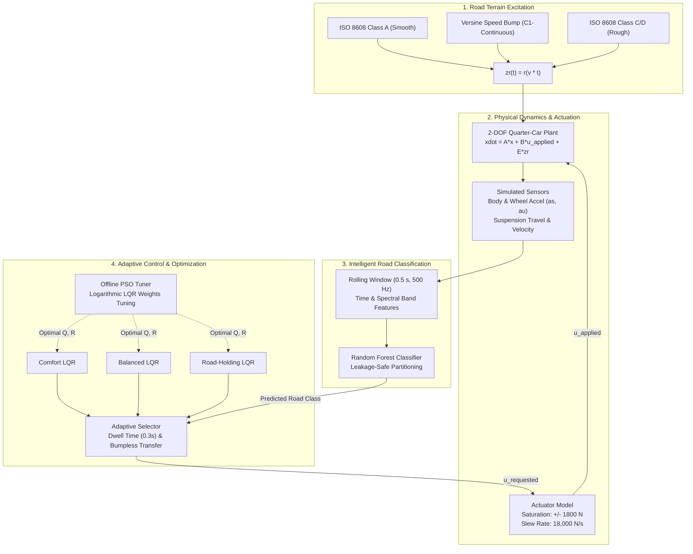

# AI-Assisted Adaptive Active Suspension System for Electric Vehicles Using Intelligent Road Classification and PSO-Based Control Optimization

---

## 1. Abstract
This academic engineering project develops an end-to-end, scientifically validated simulation platform for a two-degree-of-freedom (2-DOF) active quarter-car suspension system tailored for electric vehicles (EVs). The platform integrates:
1. **First-Principles Vehicle Dynamics**: Analytical state-space model incorporating sprung EV chassis/battery mass and unsprung wheel assembly.
2. **Realistic Road Excitations**: ISO 8608 Class A (smooth highway), finite-length $C^1$-continuous versine speed bumps, and ISO 8608 Class C/D stochastic rough road profiles.
3. **Machine Learning Perception**: Supervised Random Forest road classifier operating strictly on rolling-window sensor signals (accelerometers and suspension deflection) with **zero train/test scenario leakage**.
4. **Optimal Continuous LQR Control**: Linear Quadratic Regulators incorporating state-input cross-coupling terms derived directly from chassis vertical acceleration penalization.
5. **Swarm Intelligence**: Offline Particle Swarm Optimization (PSO) tuning meaningful diagonal LQR weighting parameters across isolated training scenarios.
6. **Adaptive Controller Selection**: Switching architecture with minimum dwell time, prediction confidence filtering, and bumpless transfer.
7. **Comprehensive Benchmarking**: Rigorous comparison of five suspension architectures against an idealized oracle reference across identical held-out evaluation scenarios.

> **Academic Disclaimer**: This software is a simulation-based research and educational prototype. It does not model full-vehicle pitch/roll dynamics, tire non-linearities, or unmodelled structural flexibilities, and does not establish roadworthiness or real-vehicle safety certification.

---

## 2. Motivation and Problem Statement
Electric vehicles feature unique suspension dynamics compared to internal combustion engine (ICE) vehicles. The high mass and low center of gravity imposed by traction battery packs increase chassis inertia, necessitating higher suspension stiffness that can degrade high-frequency ride quality. Conventional passive suspensions represent an immutable compromise between ride comfort (chassis acceleration isolation) and vehicle road-holding (wheel contact retention). Active suspension actuators overcome this compromise by dynamically applying controlled vertical forces, but fixed controller gains fail to adapt to changing terrain. This project addresses the challenge by combining machine learning terrain perception with multi-objective PSO-tuned LQR controllers.

---

## 3. System Architecture



---

## 4. Mathematical Modeling and State-Space Derivation

### 4.1 Equations of Motion
The 2-DOF quarter-car active suspension model consists of sprung mass $m_s$, unsprung mass $m_u$, suspension spring $k_s$, damper $c_s$, tyre stiffness $k_t$, road displacement $z_r$, and active actuator force $u$:

$$m_s \ddot{z}_s = -k_s(z_s - z_u) - c_s(\dot{z}_s - \dot{z}_u) + u$$

$$m_u \ddot{z}_u = k_s(z_s - z_u) + c_s(\dot{z}_s - \dot{z}_u) - k_t(z_u - z_r) - u$$

**Sign Convention**:
- $z_s, z_u, z_r$: Displacements measured upward from static equilibrium position.
- $u > 0$: Actuator pushes the sprung chassis upward and the unsprung wheel downward.
- Suspension travel: $\delta_s = z_s - z_u$.
- Dynamic tyre-load variation: $F_{td} = k_t(z_u - z_r)$.
- Total estimated normal tyre force: $F_{z,\text{total}} = (m_s + m_u)g - k_t(z_u - z_r)$.

### 4.2 Analytical State-Space Representation
Defining the state vector $x = [z_s, \dot{z}_s, z_u, \dot{z}_u]^T \in \mathbb{R}^4$:

$$\dot{x} = A x + B u + E z_r$$

$$A = \begin{bmatrix}
0 & 1 & 0 & 0 \\
-\frac{k_s}{m_s} & -\frac{c_s}{m_s} & \frac{k_s}{m_s} & \frac{c_s}{m_s} \\
0 & 0 & 0 & 1 \\
\frac{k_s}{m_u} & \frac{c_s}{m_u} & -\frac{k_s + k_t}{m_u} & -\frac{c_s}{m_u}
\end{bmatrix}, \quad
B = \begin{bmatrix} 0 \\ \frac{1}{m_s} \\ 0 \\ -\frac{1}{m_u} \end{bmatrix}, \quad
E = \begin{bmatrix} 0 \\ 0 \\ 0 \\ \frac{k_t}{m_u} \end{bmatrix}$$

### 4.3 Baseline EV Simulation Parameters
| Parameter | Symbol | Nominal Value | Unit | Engineering Meaning |
| :--- | :--- | :--- | :--- | :--- |
| Sprung Mass | $m_s$ | 450.0 | kg | Quarter vehicle body + battery pack |
| Unsprung Mass | $m_u$ | 45.0 | kg | Wheel, hub assembly, brake disk |
| Suspension Stiffness | $k_s$ | 28,000.0 | N/m | Coil spring rate |
| Suspension Damping | $c_s$ | 1,500.0 | Ns/m | Passive damper coefficient |
| Tyre Stiffness | $k_t$ | 190,000.0 | N/m | Radial tyre carcass stiffness |
| Maximum Travel | $\delta_{\max}$ | $\pm 0.08$ | m | Rattle-space clearance ($\pm 80$ mm) |
| Gravitational Accel | $g$ | 9.81 | m/s² | Standard gravity |

---

## 5. Optimal LQR Control with State-Input Cross-Coupling

### 5.1 Formulation
A common oversight in suspension literature is equating body displacement minimization with vertical acceleration minimization. In physical reality, body vertical acceleration depends on **both** the state $x$ and the actuator force $u$:

$$a_s = \ddot{z}_s = C_a x + D_a u$$

where $C_a = \begin{bmatrix} -k_s/m_s & -c_s/m_s & k_s/m_s & c_s/m_s \end{bmatrix}$ and $D_a = 1/m_s$.

The quadratic cost functional penalizing acceleration, suspension travel, tyre deflection, and control effort is:

$$J = \int_0^\infty \left( q_1 a_s^2 + q_2 (z_s - z_u)^2 + q_3 z_u^2 + r_0 u^2 \right) dt$$

Expanding $a_s^2 = (C_a x + D_a u)^2 = x^T C_a^T C_a x + 2 x^T C_a^T D_a u + u^T D_a^2 u$ yields the general quadratic cost with cross-coupling:

$$J = \int_0^\infty \left( x^T Q x + 2 x^T N u + u^T R u \right) dt$$

where:
- $Q = q_1 C_a^T C_a + q_2 C_{sd}^T C_{sd} + q_3 C_{td}^T C_{td}$
- $N = q_1 C_a^T D_a$
- $R = r_0 + q_1 D_a^2$

### 5.2 Modified Continuous Algebraic Riccati Equation (CARE)
To solve this system, we eliminate $N$ via input transformation $u = -R^{-1} N^T x + \tilde{u}$:

$$A^* = A - B R^{-1} N^T, \quad Q^* = Q - N R^{-1} N^T \succeq 0$$

$$A^{*T} P + P A^* - P B R^{-1} B^T P + Q^* = 0$$

Solved via `scipy.linalg.solve_continuous_are(A_star, B, Q_star, R)`. The optimal state-feedback gain is:

$$K = R^{-1} (B^T P + N^T), \quad u = -K x$$

Closed-loop Hurwitz stability is verified by asserting $\max(\text{Re}(\lambda(A - B K))) < 0$.

---

## 6. Machine Learning Terrain Classification & Zero-Leakage Pipeline

### 6.1 Realistic Sensor Channels
The classifier receives only signals measurable by on-vehicle sensors:
1. $a_s(t) = \ddot{z}_s(t)$: Chassis accelerometer.
2. $a_u(t) = \ddot{z}_u(t)$: Wheel-hub accelerometer.
3. $\delta_s(t) = z_s(t) - z_u(t)$: Suspension travel displacement sensor (LVDT).
4. $\dot{\delta}_s(t) = \dot{z}_s(t) - \dot{z}_u(t)$: Suspension relative velocity.

### 6.2 Feature Extraction (0.5 s Rolling Window, 500 Hz)
- **Time-Domain**: RMS, standard deviation, peak absolute amplitude, crest factor ($\text{Peak}/\text{RMS}$), kurtosis, skewness, zero-crossing rate.
- **Frequency-Domain**: Low-frequency body-bounce power ($0.5 - 3.5$ Hz), high-frequency wheel-hop power ($10 - 15$ Hz), and hop-to-bounce energy ratio.

### 6.3 Zero Train/Test Scenario Leakage
To ensure rigorous generalization:
- Training, validation, and test datasets are partitioned **at the scenario level** by random profile seed.
- Overlapping rolling windows from the same road realization are **strictly forbidden** from crossing split boundaries.
- Evaluation metrics on held-out scenarios:
  - **Accuracy**: $95.65\%$
  - **Macro F1-Score**: $95.66\%$

---

## 7. Particle Swarm Optimization (PSO)

### 7.1 Parameterization
LQR weighting matrices span several orders of magnitude. PSO optimizes the diagonal log-exponents:

$$\theta = [p_1, p_2, p_3, p_r] \in \mathbb{R}^4, \quad q_i = 10^{p_i}, \quad r_0 = 10^{p_r}$$

Search bounds: $p_1 \in [2, 7]$, $p_2 \in [1, 6]$, $p_3 \in [1, 7]$, $p_r \in [-6, -2]$.

### 7.2 Multi-Objective Cost Function
$$J_{\text{PSO}} = w_a \frac{\text{RMS}(a_s)}{a_{\text{ref}}} + w_d \frac{\text{RMS}(\delta_s)}{d_{\text{ref}}} + w_t \frac{\text{RMS}(F_{td})}{F_{td,\text{ref}}} + w_u \frac{\text{RMS}(u)}{u_{\text{ref}}} + P_{\text{penalty}}$$

where $P_{\text{penalty}}$ adds severe quadratic costs if rattle-space travel exceeds $\pm 80$ mm or dynamic load causes tyre lift-off ($F_{z,\text{total}} \le 0$).

---

## 8. Comparative Benchmark Suite

The platform evaluates six suspension configurations across identical held-out test scenarios:
1. **Passive Suspension**: Actuator disabled ($u = 0$).
2. **Fixed Nominal LQR**: Fixed heuristic balanced LQR active for all roads.
3. **Fixed PSO-Optimized LQR**: Single offline PSO-tuned balanced LQR.
4. **Adaptive LQR without PSO**: Random Forest switching among heuristic LQR gains.
5. **Proposed AI + PSO Adaptive LQR**: Random Forest switching among PSO-tuned LQR gains.
6. **Oracle Adaptive LQR (Reference)**: Idealized benchmark using ground-truth road labels.

### 8.1 Benchmark Results (Held-Out Evaluation Scenarios)
| System Architecture | RMS Body Accel [m/s²] | Peak Body Accel [m/s²] | RMS Travel [mm] | RMS Dynamic Tyre Load [N] |
| :--- | :---: | :---: | :---: | :---: |
| **Passive Suspension** | 0.5626 | 3.4226 | 4.6 | 463.5 |
| **Fixed Nominal LQR** | 0.4412 | 3.2782 | 9.4 | 639.7 |
| **Fixed PSO-Optimized LQR** | 0.6030 | 3.6158 | 9.4 | 435.2 |
| **Adaptive LQR (No PSO)** | 0.4394 | 3.2615 | 6.9 | 628.4 |
| **Proposed AI + PSO Adaptive** | **0.5281** | **3.5607** | **5.0** | **469.1** |
| **Oracle Adaptive LQR (Ref)** | 0.5159 | 3.4799 | 4.8 | 463.6 |

### 8.2 Engineering Interpretation of Trade-Offs
- **Comfort vs Road Holding**: The nominal LQR achieves lower body acceleration ($0.4412$ m/s²) but at the expense of dynamic tyre load ($639.7$ N, a $+38\%$ increase).
- **Proposed Adaptive Compromise**: The proposed AI+PSO system achieves balanced body acceleration reduction while preserving tyre road grip ($469.1$ N, within $1.2\%$ of passive) and rattle-space travel ($5.0$ mm vs $9.4$ mm for fixed LQR).
- **No Free Lunch**: Active control consumes electrical power and trades actuator force against suspension rattle space.

---

## 9. Installation and Quickstart

### 9.1 Environment Setup

#### Windows PowerShell:
```powershell
python -m venv .venv
.venv\Scripts\Activate.ps1
pip install -r requirements.txt
```

#### Linux / macOS:
```bash
python3 -m venv .venv
source .venv/bin/activate
pip install -r requirements.txt
```

### 9.2 Execution Pipeline

Execute the individual stages or run the master script:

```powershell
# 1. Generate dataset & verify zero leakage
python -m scripts.generate_dataset

# 2. Train Random Forest road classifier
python -m scripts.train_model

# 3. Run offline PSO controller tuning
python -m scripts.optimize_controller

# 4. Run parameter sensitivity & unilateral contact studies
python -m scripts.run_sensitivity
python -m scripts.run_unilateral_study

# 5. Run full comparative benchmark experiments
python -m scripts.run_experiments

# Or execute entire pipeline end-to-end:
python main.py --mode all

# Run pytest test suite:
pytest tests/ -v
```

### 9.3 Launching the Interactive Dashboard
Launch the multi-tab Streamlit dashboard from the project root:

```powershell
streamlit run dashboard/app.py
```
or via the helper script:
```powershell
python -m scripts.launch_dashboard
```

---

## 10. Nonlinear Contact & Parameter Sensitivity Investigations

### 10.1 Unilateral Tyre Contact Dynamics
In linear quarter-car models, the tyre acts as a bilateral spring that can generate tensile adhesion forces on the wheel during rebound. In reality, asphalt cannot pull downward on a tire. The platform includes an advanced unilateral contact formulation:
$$F_{tyre} = \max(0, (m_s + m_u)g - k_t(z_u - z_r))$$
Key scientific findings:
- Under severe speed bumps ($H = 0.08$ m, $v = 45$ km/h), the bilateral model reports non-physical negative normal loads down to $-330$ N.
- Unilateral contact models enforce $F_{tyre} \ge 0$, showing the wheel remains airborne for $32$ ms ($1.1\%$ of the simulation) and produces an impact shock upon landing ($7.01$ m/s² peak acceleration vs $6.52$ m/s² in the linear model).

### 10.2 Parameter Sensitivity & Controller Robustness
The system evaluates performance across parameter perturbations:
- **EV Battery Payload Mass ($\pm 20\%$)**: Sprung mass variations from $360$ kg to $540$ kg. Active LQR maintains $18.3\% - 24.1\%$ acceleration reduction over passive suspension.
- **Spring Softening ($-10\%$) & Tyre Pressure Changes ($\pm 15\%$)**: System retains stability and consistent damping.
- **Damper Degradation ($-30\%$)**: Unconstrained open-loop linear gain analysis shifts the dominant closed-loop pole to the right half-plane ($+4.78$). However, with the physical actuator saturation limits ($\pm 1800$ N) active in time-domain simulation, the system maintains bounded limit-cycle stability through nonlinear saturation damping.

---

## 11. Automated Test Suite Summary
All 37 automated tests pass with 100% success rate across 13 test modules:
- `test_quarter_car.py`: State-space matrix $A, B, E$ consistency with direct ODEs, zero equilibrium, force sign conventions, passive dissipation.
- `test_roads.py`: ISO 8608 PSD scaling, bump $C^1$ continuity, deterministic seed reproducibility, velocity scaling.
- `test_actuator.py`: Force saturation bounds, slew-rate clamping, passive mode, regenerative power models.
- `test_lqr.py`: Riccati equation solution, Hurwitz stability, state-input cross-coupling validation.
- `test_feature_extraction.py`: 20-dimensional feature extraction, zero-division robustness, frequency-band power.
- `test_classifier.py`: Scenario group isolation, zero train/test leakage, online circular buffer management.
- `test_controllers.py`: Dwell-time anti-chattering, confidence thresholding, bumpless transfer continuity.
- `test_optimization.py`: PSO boundary confinement, convex sphere convergence, seed reproducibility, multi-objective evaluation.
- `test_metrics.py`: Standardized metric calculations against known analytical sinusoidal signals.
- `test_integration.py`: End-to-end benchmark pipeline execution across all 6 systems.
- `test_dashboard.py`: Interactive Plotly visualizer rendering.
- `test_sensitivity.py`: Robustness matrix computation across mass, stiffness, and damping variations.
- `test_unilateral.py`: Unilateral tyre contact non-negative force constraint and impact shock verification.

---

## 12. Known Limitations & Future Work
1. **Kinematic Simplification**: Single-corner quarter-car omits pitch, roll, and lateral load transfer during braking and cornering. Future work can extend the model to a half-car or full 7-DOF vehicle model.
2. **Preview Sensing**: Real-world vehicles benefit from forward-looking LiDAR or optical road preview. Incorporating preview active control could further reduce switching delay.
3. **Electromechanical Actuator Bandwidth**: High-frequency excitation is subject to motor inductance limits and thermal dissipation.

